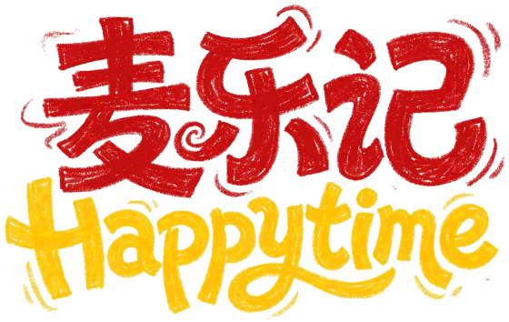

<div align="center">



# happytime 麦乐记（happytime-mcd-skill）

**把今天的开心事，变成一张手绘绘本风的「Happytime 贺卡」；配上照片，还能出一张「麦乐漫记」三联插画。**

`麦当劳中国 MCP` · `腾讯 WorkBuddy Skill` · `麦当劳程序员创意开发大赛参赛作品`

</div>

---

## 效果预览

| Happytime 贺卡（16:9） | 麦乐漫记（3:4，有照片时） |
|:---:|:---:|
|  |  |
| 手绘绘本背景三选一 + 砖红手写标题 + 关键词彩色笔触 | AI 图生图一次出整张三联插画 + 牛皮纸手写题字 |

> 完整的在线版 Web 应用（v4 手绘绘本版）：<https://happytime-jileji.app.workbuddy.host/index4.html>

## 这是什么

「happytime 麦乐记」起源于一个很小的场景：孩子每天都会遇到一件小小的开心事——跳绳比赛赢了、终于学会骑自行车、和好朋友在楼下玩到天黑。家长想留住这些瞬间，也想顺手兑现一个「今晚吃麦当劳」的小奖励。

这个 Skill 把它做成一个小仪式：

> **开心事 → Happytime 文案（短语 time + 2~3 句）→ 心情选餐（麦当劳 MCP 实时数据）→ 儿童营养卡 → Happytime 贺卡（16:9）→ 麦乐漫记（3:4）**

1. **听开心事**：家长（或孩子）说一句今天发生的事；不知道写什么时，从 15 条灵感池里挑一条。
2. **写 Happytime 文案**：`短语 time`（2~6 字 + time，如「胜利击掌time」）+ 2~3 个短句（合计 40~70 字，用「你」称呼孩子），像爸爸妈妈念给孩子听的话。
3. **心情选餐**：调用麦当劳中国 MCP 拉取**真实**的门店在售菜单与营养数据，按开心事的气氛（庆祝/补充能量/分享/暖暖的）从清单里推荐 1 份餐品，顺便查券算价，绝不编造。
4. **儿童营养卡**：能量/碳水/蛋白质/脂肪/钠/钙六项，按 7~10 岁每日参考量折算成进度条，只做直觉参考。
5. **出片**：
   - **Happytime 贺卡（16:9，随时可出）**：手绘绘本背景三选一 + 砖红手写大标题 + 黑墨寄语（关键词彩色笔触）。
   - **麦乐漫记（3:4，有照片时）**：图生图**一次出整张**三联插画（左格高光时刻 + 右格今日餐品 + 下方孩子享用大图 + 底部牛皮纸手写题字），程序只补麦乐记字标与日期；图像生成不可用时走本地版式兜底（照片 + 牛皮纸纸带题字）。

## 目标用户

- **3~12 岁孩子的家长**：把「吃麦当劳」变成记录与肯定孩子一天的小仪式；
- **麦门年轻用户**：想要一份「只属于今天的心情」的点餐仪式感；
- **想快速查营养/找店/领券的普通点餐用户**。

## 安装方法

### 前置条件

1. 申请麦当劳中国 MCP Token：打开 [https://mcp.mcd.cn](https://mcp.mcd.cn) → 登录 → 控制台 → 激活，复制 Token。
2. 安装腾讯 [WorkBuddy](https://www.workbuddy.cn/)。

### 第 1 步：接入麦当劳 MCP（WorkBuddy）

左侧边栏【专家·技能·连接器】→【连接器】→ 右上角【自定义连接器】→【配置MCP】，粘贴（替换 `YOUR_MCP_TOKEN`）：

```json
{
  "mcpServers": {
    "mcd-mcp": {
      "type": "streamablehttp",
      "url": "https://mcp.mcd.cn",
      "headers": {
        "Authorization": "Bearer YOUR_MCP_TOKEN"
      }
    }
  }
}
```

保存后启用 `mcd-mcp`。脱敏配置示例见 [`mcp-config.example.json`](mcp-config.example.json)，接入细节与工具调用流程见 [`MCP_INTEGRATION.md`](MCP_INTEGRATION.md)。

### 第 2 步：安装本 Skill

1. 下载/克隆本仓库；
2. 在 WorkBuddy 中把本目录作为本地技能安装（或直接把 [`SKILL.md`](SKILL.md) 作为系统指令使用）；
3. 开聊：告诉它今天的一件开心事。

## 使用示例

```
你：今天孩子足球比赛赢了！
AI：胜利击掌time —— 汗水顺着刘海蹭花了小脸蛋。和队友拍红的掌心，装着满当当的开心。
    （MCP：now-time-info / list-nutrition-foods / query-nearby-stores / query-meals）
    推荐：巨无霸 + 营养卡六项进度
    → 出 Happytime 贺卡 happytime-卡-2026-10-13.html
    （有照片时继续 → 麦乐漫记 麦乐漫记-2026-10-13.html）
```

```
你：麦乐鸡块热量多少？
AI：（list-nutrition-foods）180 千卡/4 块，蛋白质 9g……（营养卡）
```

```
你：下雨天想吃点热乎的
AI：→ 心情选餐走「暖暖的」方向，给推荐理由 + 营养卡 +（可选）附近门店与算价
```

样例产出物在 [`example-output/`](example-output/)（浏览器直接打开即见效果），对应预览图在 [`images/`](images/)。

## 项目结构

```
happytime-mcd-skill/
├── SKILL.md                     # Skill 本体（五步工作流程与规则）
├── README.md                    # 本文件
├── MCP_INTEGRATION.md           # 麦当劳 MCP 接入说明（Server/Tool/流程/业务价值）
├── CONTEST_DECLARATION.md       # 参赛声明（官方原文）
├── mcp-config.example.json      # 脱敏的 MCP 配置示例（仅环境变量占位符）
├── workbuddy.md                 # 使用 WorkBuddy 开发的对话记录
├── references/                  # 渐进式加载的领域知识
│   ├── mcp-tool-calling.md      #   MCP 调用约定、解析坑、产品图本地化
│   ├── happytime-copy-guide.md  #   文案口径 + 15 条灵感池 + 漫记题字
│   ├── mood-meal-guide.md       #   心情 → 餐品推荐策略
│   ├── nutrition-guide.md       #   儿童营养参考值与小知识
│   └── visual-guide.md          #   v4 视觉规范（贺卡 / 漫记 / 出图提示词）
├── templates/
│   ├── happytime-card-template.html  # Happytime 贺卡 16:9（关键词自动染色）
│   └── postcard-template.html        # 麦乐漫记 3:4 兜底版式
├── scripts/
│   ├── fetch-mcd-menu.mjs       # MCP 数据同步脚本（Node 直连）
│   └── render-preview.mjs       # 样例产出物预览图渲染脚本（Playwright）
├── example-output/              # 样例产出（贺卡 / 漫记，浏览器直接打开）
├── images/                      # README 预览图
└── assets/                      # 小薯吉祥物、绘本背景、产品插画、纸纹、字标、字体
```

## 使用的麦当劳 MCP 工具一览

| 工具 | 用途 |
|---|---|
| `now-time-info` | 当前日期（贺卡/漫记落款） |
| `list-nutrition-foods` | 全量营养表（约 158 条） |
| `query-nearby-stores` | 附近可用门店 |
| `query-meals` / `query-meal-detail` | 在售菜单 / 套餐组成 |
| `query-store-coupons` / `available-coupons` / `auto-bind-coupons` | 查券 / 领券 |
| `calculate-price` / `create-order` | 算价 / 下单（下单前强制二次确认） |

详细的调用流程、参数与踩坑记录见 [`MCP_INTEGRATION.md`](MCP_INTEGRATION.md)。

## 素材与字体授权

- 视觉素材（小薯吉祥物 5 态、三张手绘绘本背景、纸纹、产品插画、麦乐记字标）为本项目 AI 生成 / 自制，可随项目开源；样例照片为 AI 生成，非真人。
- 字体：**站酷快乐体 ZCOOL KuaiLe**、**马善政毛笔楷书 Ma Shan Zheng**（免费商用），**霞鹜文楷 LXGW WenKai**（SIL OFL）；仓库内嵌 woff2 仅用于产出物渲染，转载时请保留致谢。
- 餐品营养与菜单数据来自麦当劳中国 MCP 的实时返回，版权归麦当劳中国所有。

## 声明

本项目为麦当劳程序员创意开发大赛参赛作品，由参赛者独立开发，非麦当劳官方产品。餐品、价格、供应状态以麦当劳官方渠道实时结果为准；营养内容仅为直觉参考，不构成医疗或膳食建议。详见 [`CONTEST_DECLARATION.md`](CONTEST_DECLARATION.md)。

---

<div align="center">

如果这个项目对你有启发，欢迎点一个 ⭐ Star，也欢迎 Issue 交流！

</div>
